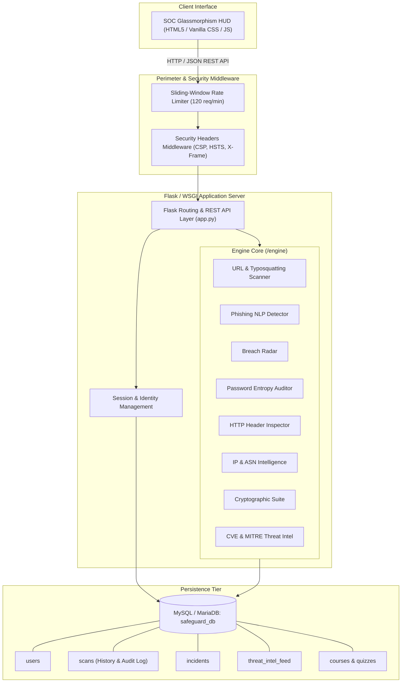

<p align="center"></p>

# Gasha — Enterprise Cybersecurity & Threat Intelligence Platform

> **Gasha** (ጋሻ) is the Amharic name for the traditional Ethiopian war shield — a round, hand-made hide shield carried by warriors to turn aside blows. The platform takes its name from it: a defensive layer between you and the threats aimed at you.

<p align="center">
  
  
  
  
  
  
</p>

---

## 📖 Executive Summary

**Gasha** is an enterprise-grade, all-in-one Cybersecurity Operations Center (SOC) and Threat Intelligence Platform. Engineered for SecOps analysts, incident response teams, and organizations seeking proactive defense, Gasha combines multi-vector heuristic scanning engines, real-time threat intelligence feeds, MITRE ATT&CK taxonomy mapping, gamified cybersecurity training, and persistent audit logging.

Built with a native **Python WSGI / Flask** architecture and **MySQL/MariaDB** persistence, Gasha can run locally on bare-metal workstations, scale across enterprise cloud instances with **Gunicorn**, or seamlessly deploy onto **cPanel shared hosting & VPS** via **Phusion Passenger**.

---
Behind the Gasha. Members who helped in making the gasha platform come to life: 

Name:                           CTC
1. Bereket Bahiru.       1144-26
2. Samuel Teshome.  2631-26
3. Rihana Abdu.          6285-26 
4. Betselot Solomon.  2200-26
5. Natinael Kifle :         1532-26
6. Fikre Hailemariam:  1751-26
---
video - https://drive.google.com/file/d/1Ah7ZTmOpPyFluWXgHDphJGS-913Tb6dN/view?usp=sharing

## ⚡ Core Capabilities & Architectural Pillars

### 1. 🔍 Cyber Threat Analysis Engines (`/engine`)
* **URL & Domain Heuristic Radar (`engine/url_scanner.py`)**:
  * Typosquatting & Levenshtein distance calculations against monitored global corporate brands.
  * Homoglyph / Internationalized Domain Name (IDN) spoofing detection (Cyrillic/Greek unicode substitutions).
  * Shannon entropy analysis on domain names and URI paths to detect algorithmic domain generation (DGA).
  * High-risk malicious Top-Level Domain (TLD) correlation and obfuscated parameter inspection.
* **Phishing & Social Engineering NLP Engine (`engine/phishing_detector.py`)**:
  * Analyzes email bodies, SMS messages, and chat scripts for social engineering vectors.
  * Detects urgency triggers, authority pressure, financial coercion, and credential harvesting patterns.
* **Data Breach & Exposure Radar (`engine/breach_checker.py`)**:
  * Scans corporate emails and domains against known historical breach dumps and compromise surfaces.
  * Categorizes exposed sensitive data types (passwords, PII, financial information).
* **Password Fortress & Zero-Knowledge Entropy Auditor (`engine/password_audit.py`)**:
  * Zero-knowledge audit: raw passwords are never stored in the database.
  * Computes total character pool diversity and Shannon entropy bits.
  * Estimates realistic brute-force crack timelines against modern multi-GPU hashcat arrays.
* **HTTP Perimeter Header Inspector (`engine/header_inspector.py`)**:
  * Conducts live perimeter header audits on external domains.
  * Evaluates Content Security Policy (CSP), HTTP Strict Transport Security (HSTS), X-Frame-Options, X-Content-Type-Options, Referrer-Policy, and Permissions-Policy.
  * Awards industry letter grades ($A^+$ through $F$) with actionable remediation snippets.
* **IP Threat Intelligence & Network Routing (`engine/ip_intel.py`)**:
  * Bogon, loopback, and RFC-1918 private IP validation.
  * Autonomous System Number (ASN) attribution, geolocation tracking, and Tor/VPN/proxy detection.
* **Cryptographic Suite & Payload Transformer (`engine/crypto_tools.py`)**:
  * On-the-fly cryptographic hash generation (`MD5`, `SHA-1`, `SHA-256`, `SHA-512`).
  * Automated hash format identification engine.
  * Payload encodings/decodings: `Base64`, `Hexadecimal`, `URL encoding`, and `ROT13`.

### 2. 🎓 Interactive Learning Academy
* **Video Masterclasses**: Curated cybersecurity courses with syllabi and embedded video lectures.
* **Knowledge Check Quizzes**: Interactive scenario-based quizzes with automated evaluation, rationale explanations, and persistent score records.
* **Field Cheatsheets**: Downloadable SecOps quick-reference guides covering incident command, Linux hardening, and network triage.

### 3. 🚨 Threat Intelligence & Incident Response Center
* **Active CVE Tracker**: Live stream of critical vulnerability alerts mapped to CVSS v3.1 vector strings.
* **MITRE ATT&CK Matrix**: Tactical alignment with real-world enterprise adversary techniques.
* **Response Playbooks**: Standard Operating Procedures (SOPs) for ransomware containment, phishing compromise, and credential stuffing.

### 4. 🛡️ Enterprise Hardening & Access Control
* **Sliding-Window Rate Limiter**: In-memory token bucket enforcing 120 requests/minute per IP to neutralize automated API abuse.
* **Strict HTTP Security Perimeter**: `X-Frame-Options: DENY`, `X-Content-Type-Options: nosniff`, `Strict-Transport-Security`, and restrictive `Content-Security-Policy`.
* **Role-Based Authentication**: Secure session authentication using PBKDF2 / SHA-256 password hashing.

---

## 🏛️ System Architecture



---

## 🗂️ Project Directory Structure

```text
safeguard/
├── .htaccess                 # Apache / LiteSpeed cPanel Passenger configuration
├── README.md                 # Primary project documentation
├── README_CPANEL.md          # Dedicated cPanel deployment guide
├── requirements.txt          # Production Python dependencies
├── schema.sql                # Complete MySQL schema & table definitions
├── app.py                    # Flask application, REST API endpoints & security middleware
├── database.py               # MySQL connection pool, ORM routines & auto-seeding logic
├── passenger_wsgi.py         # Phusion Passenger WSGI entry point for cPanel
├── wsgi.py                   # Standard WSGI entry point for Gunicorn / Linux VPS
│
├── engine/                   # Specialized heuristic and cyber intelligence modules
│   ├── __init__.py           # Package exports
│   ├── url_scanner.py        # Typosquatting, homoglyphs, brand spoofing & entropy
│   ├── phishing_detector.py  # NLP heuristic detector for social engineering
│   ├── breach_checker.py     # Breach intelligence and exposure auditing
│   ├── password_audit.py     # NIST entropy scoring and crack time calculation
│   ├── header_inspector.py   # Live HTTP security header grading
│   ├── ip_intel.py           # Bogon check, ASN lookup & risk attribution
│   ├── crypto_tools.py       # Multi-hash generation, format detection & payload encodings
│   └── threat_intel.py       # CVE catalog, MITRE ATT&CK taxonomy & incident playbooks
│
├── static/                   # Static assets
│   ├── css/
│   │   └── main.css          # Responsive dark-theme HUD styles & purple neon styling
│   └── js/
│       └── app.js            # Frontend application logic, API async fetching & DOM controls
│
└── templates/                # Jinja2 presentation templates
    └── index.html            # Main Cyber Intelligence Command Center interface
```

---

## 🧰 Technology Stack

| Component | Technology | Description |
| :--- | :--- | :--- |
| **Backend Language** | Python 3.10+ | Core algorithmic logic & REST API |
| **Web Framework** | Flask 2.3+ | Lightweight WSGI microframework |
| **WSGI Servers** | Phusion Passenger / Gunicorn | cPanel hosting & Linux production deployment |
| **Database** | MySQL 8.0+ / MariaDB 10.4+ | Persistent storage for users, scans, telemetry, and quizzes |
| **Database Driver** | PyMySQL | Pure-Python client compatible with standard and shared hosting |
| **Cryptography** | Werkzeug / Cryptography | Secure password hashing (PBKDF2/SHA256) & cipher utilities |
| **Frontend** | Vanilla HTML5, CSS3, ES6+ JS | Zero external framework overhead; ultra-fast rendering |
| **Typography & Icons**| Google Fonts, FontAwesome 6 | JetBrains Mono, Nunito, Roboto & cybersecurity glyphs |

---

## 🚀 Getting Started (Local Development)

### 1. Prerequisites
Ensure you have the following installed on your host machine:
* **Python 3.10+**: Verify via `python --version` or `python3 --version`.
* **MySQL or MariaDB Server**: Available via XAMPP, Docker, or native service.
* **Git**: To clone and version-control the codebase.

### 2. Clone the Repository
```bash
git clone https://github.com/Beki1238/safeguard-cybersecurity-platform.git
cd safeguard-cybersecurity-platform
```

### 3. Setup Virtual Environment
```bash
# Windows (PowerShell / Command Prompt)
python -m venv venv
.\venv\Scripts\activate

# macOS / Linux
python3 -m venv venv
source venv/bin/activate
```

### 4. Install Dependencies
```bash
pip install -r requirements.txt
```

### 5. Configure Database & Environment
Gasha automatically connects to local MySQL with default credentials (`127.0.0.1:3306`, user `root`, blank password). If your MySQL server requires specific credentials, configure environment variables:

#### On Windows (PowerShell):
```powershell
$env:DB_HOST="127.0.0.1"
$env:DB_PORT="3306"
$env:DB_USER="root"
$env:DB_PASSWORD="YourPasswordHere"
$env:DB_NAME="safeguard_db"
$env:SECRET_KEY="your-custom-production-secret-key"
```

#### On Linux / macOS:
```bash
export DB_HOST="127.0.0.1"
export DB_PORT="3306"
export DB_USER="root"
export DB_PASSWORD="YourPasswordHere"
export DB_NAME="safeguard_db"
export SECRET_KEY="your-custom-production-secret-key"
```

> **Automatic Schema Bootstrapping:** Gasha automatically provisions the `safeguard_db` database and builds all necessary tables on startup if they do not exist. You can also manually import the schema via:
> ```bash
> mysql -u root -p < schema.sql
> ```

### 6. Run the Application
```bash
python app.py
```
Open your browser and navigate to:
```text
http://127.0.0.1:5000
```

---

## 🔑 Default Administrator Credentials

When initialized on an empty database, Gasha automatically seeds a default SecOps administrator account:

| Field | Default Value | Note |
| :--- | :--- | :--- |
| **Username** | `admin` | Case-insensitive login |
| **Email** | `admin@gasha.local` | Primary SOC admin contact |
| **Password** | `Admin@123456` | Change immediately upon deployment |
| **Role** | `Lead SecOps Officer` | Unrestricted audit visibility |

---

## 📡 REST API Reference

All scan and audit operations expose JSON API endpoints protected by sliding-window rate limiting.

### 🛡️ Heuristic Scanning Endpoints

| Method | Endpoint | Description | Request Body Payload |
| :--- | :--- | :--- | :--- |
| `POST` | `/api/scan/url` | Scans domain for phishing, typosquatting & homoglyphs | `{"url": "https://suspicious-paypa1.com"}` |
| `POST` | `/api/scan/message` | Analyzes text for social engineering vectors | `{"text": "URGENT: Click here to verify bank account"}` |
| `POST` | `/api/scan/email` | Audits email for historical data breach exposure | `{"email": "analyst@target-company.com"}` |
| `POST` | `/api/audit/password` | Zero-knowledge entropy & brute-force audit | `{"password": "SamplePassword#2026"}` |
| `POST` | `/api/audit/headers` | Inspects live target domain HTTP security headers | `{"url": "https://example.com"}` |
| `POST` | `/api/audit/ip` | Audits IP address for ASN, Bogon status & threat tier | `{"ip": "198.51.100.24"}` |

### 🔐 Cryptographic Endpoints

| Method | Endpoint | Description | Request Body Payload |
| :--- | :--- | :--- | :--- |
| `POST` | `/api/crypto/hashes` | Generates MD5, SHA-1, SHA-256, and SHA-512 hashes | `{"text": "SecretToken"}` |
| `POST` | `/api/crypto/identify` | Identifies possible algorithm for a given hash | `{"hash": "5d41402abc4b2a76b9719d911017c592"}` |
| `POST` | `/api/crypto/transform` | Encodes/decodes payload (`b64enc`, `hexdec`, `rot13`, etc.) | `{"text": "Payload", "operation": "b64enc"}` |

### 📊 Telemetry & Learning Endpoints

| Method | Endpoint | Description |
| :--- | :--- | :--- |
| `GET` | `/api/health` | Diagnostic system health, database connection state & version |
| `GET` | `/api/dashboard/stats` | Real-time scan metrics, incident queue & threat feed |
| `GET` | `/api/threat-intel/feed` | MITRE ATT&CK taxonomy and live CVE snapshot |
| `GET` | `/api/threat-intel/playbooks` | Standard incident response playbooks |
| `GET` | `/api/learning/courses` | Syllabus of video training courses |
| `GET` | `/api/learning/quizzes` | Catalog of cyber competency quizzes |
| `POST` | `/api/learning/quiz/submit` | Evaluates answers, provides question rationales & stores grade |
| `GET` | `/api/learning/materials` | Downloadable cheatsheets and quick-reference manuals |

---

## 🌐 Production & cPanel Deployment

Gasha is built to operate flawlessly on shared cPanel hosting (LiteSpeed/Apache with Phusion Passenger) and VPS environments.

### 📋 5-Step cPanel Quick Deploy

1. **Upload Files**:
   * Compress project contents into a `.zip` archive and upload to your cPanel `File Manager` (e.g., in `/home/user/safeguard` or subdomain root).
   * Extract all files.
2. **Setup Python App**:
   * In cPanel, navigate to **Software > Setup Python App**.
   * Choose Python **3.10**, **3.11**, **3.12**, or **3.13**.
   * Set **Application root** to `safeguard`.
   * Set **Application startup file** to `passenger_wsgi.py`.
   * Set **Application Entry point** to `application`.
3. **Install Requirements**:
   * Add `requirements.txt` under **Configuration files** and click **Run Pip Install** (or run `pip install -r requirements.txt` via cPanel Terminal).
4. **Setup MySQL in cPanel**:
   * Create a database (e.g., `user_safeguard`) in **cPanel > MySQL Databases**.
   * Add a database user with full privileges and import `schema.sql` via **phpMyAdmin**.
   * Add environment variables in cPanel Python App manager (`DB_NAME`, `DB_USER`, `DB_PASSWORD`).
5. **Restart Application**:
   * Click **Restart** in the Python App manager. Your live SOC HUD is immediately accessible via HTTPS!

*(For full details, review [README_CPANEL.md](file:///c:/Users/Bereket/Desktop/IMS/safeguard/README_CPANEL.md).)*

---

## 🔒 Security Hardening & Rate Limiting

* **Rate Limiting Protection**:
  * An in-memory sliding window algorithm tracks requests per remote IP.
  * Excessive traffic beyond 120 calls per 60 seconds returns HTTP `429 Too Many Requests`.
* **Zero-Knowledge Password Auditing**:
  * Tested passwords in `/api/audit/password` are immediately evaluated in memory and discarded. No plaintext passwords or hashes are ever saved to logs or database tables.
* **HTTP Perimeter Headers**:
  * Strict `X-Frame-Options: DENY` prevents clickjacking attacks.
  * Restrictive `Content-Security-Policy` limits script/style sources to self and trusted CDNs (Google Fonts, Cloudflare FontAwesome).
  * Payload size is capped at 2MB (`MAX_CONTENT_LENGTH`) to defend against memory exhaustion and buffer overflows.

---

## 🤝 Contributing

Contributions, bug reports, and security disclosures are welcome:
1. Fork the Project repository.
2. Create your Feature Branch (`git checkout -b feature/AdvancedHeuristics`).
3. Commit your changes (`git commit -m 'Add heuristic analyzer for QR-code phishing'`).
4. Push to the Branch (`git push origin feature/AdvancedHeuristics`).
5. Open a Pull Request.

---

## 📄 License

This project is licensed under the [MIT License](LICENSE). Gasha is designed for defensive security analysis, threat intelligence research, and cybersecurity education.
